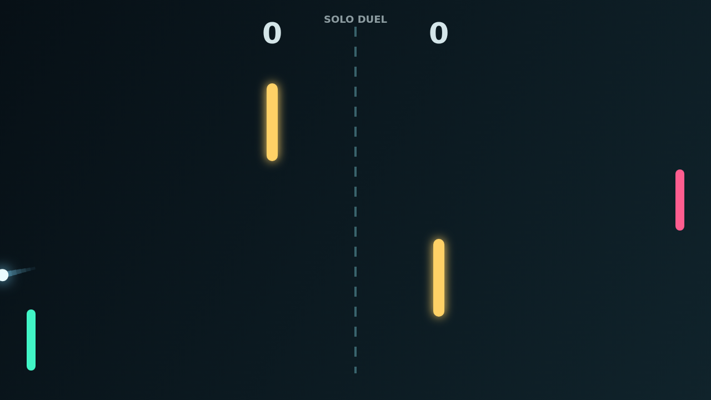

# Carom

Carom is a fast top-down paddle duel where every clean hit can become a trick
shot. The ball ricochets between bright paddles, the upper and lower walls, and
two fixed obstacles that split the center lane into dangerous angles.

The rally starts simply: keep the ball in play, read its rebound, and meet it on
the face of your paddle. Then spin takes over. Move as you strike and the ball
keeps bending after contact, opening curves that sneak around the obstacles or
force your opponent to defend a late break.

Solo mode puts you against an AI paddle that tracks incoming shots and returns
home when the pressure drops. Versus mode turns the same arena into a shared
keyboard duel, with both players chasing the first-to-11, win-by-2 finish.

The best points feel like little geometry problems solved at speed: a bank off
the top wall, a glance past the center bar, and a curved finish into the far
goal.
